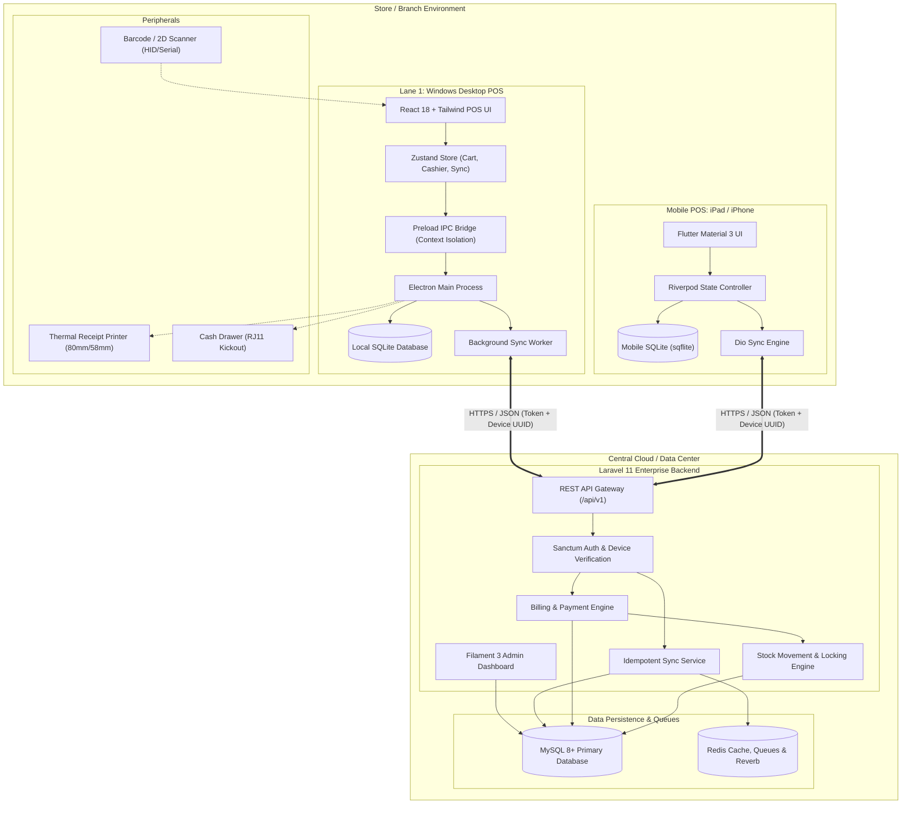

# SmartShop POS — System Architecture Specification

## 1. Architectural Overview

SmartShop POS is architected as an **offline-first, distributed retail system** with centralized cloud management. The system is designed to provide high reliability, ensuring that store checkout lanes never stop operating even during prolonged internet outages, while maintaining complete data integrity and inventory accuracy at the central backend.

---

## 2. Component Design & Responsibilities

### 2.1 Windows Desktop POS Application
- **Runtime**: Electron with Vite, React 18, and TypeScript.
- **Security Boundary**:
  - `contextIsolation: true`
  - `nodeIntegration: false`
  - All hardware access (printers, cash drawers, SQLite database) is encapsulated in Electron's Main process and exposed to the Renderer process strictly via typed `contextBridge.exposeInMainWorld('posApi', {...})`.
- **Local Persistence**: Embedded SQLite (`better-sqlite3`) in the Main process. Stores cached catalogs, offline transactions, and local sync queue.
- **State Management**: Zustand stores decoupled into `useCartStore`, `useAuthStore`, `useCatalogStore`, and `useSyncStore`.

### 2.2 Mobile POS (iPad / iPhone)
- **Runtime**: Flutter 3.x with Dart.
- **UI Framework**: Material 3 responsive layout adapting seamlessly between tablet landscape split-view and mobile portrait view.
- **Local Persistence**: `sqflite` for offline catalog and transaction queuing.
- **API Client**: `dio` with interceptors for automatic Bearer token injection, device UUID headers, and network retry handling.

### 2.3 Shared Backend & Admin System
- **Framework**: Laravel 11 on PHP 8.3+ / 8.4+.
- **Authentication**: Laravel Sanctum supporting both user sessions and cryptographically tied device tokens.
- **Authorization**: Spatie Laravel Permission with 4 core roles:
  - `Super Admin`: Full system access across all stores and configurations.
  - `Admin`: Regional or store-group management.
  - `Manager`: Store-specific management, inventory receiving, adjustments, refunds.
  - `Cashier`: Billing, register open/close, and customer lookups.
- **Admin Panel**: Filament v3 with reactive forms, data tables, metrics widgets, and CSV/PDF export.

---

## 3. Reliability & Non-Functional Requirements

1. **Sub-second Checkout**:
   - Product scanning and cart addition occurs in `< 10ms` in local memory and SQLite.
   - Offline checkout completes in `< 100ms` with local receipt generation.
2. **Zero Data Loss Guarantee**:
   - Every transaction written to local SQLite before triggering receipt printing.
   - Idempotent API guards prevent duplicate sales on server reconnection.
3. **Audit Compliance**:
   - Every stock level change generates an immutable `StockMovement` row with movement type, delta, before/after values, and originating transaction UUID.
