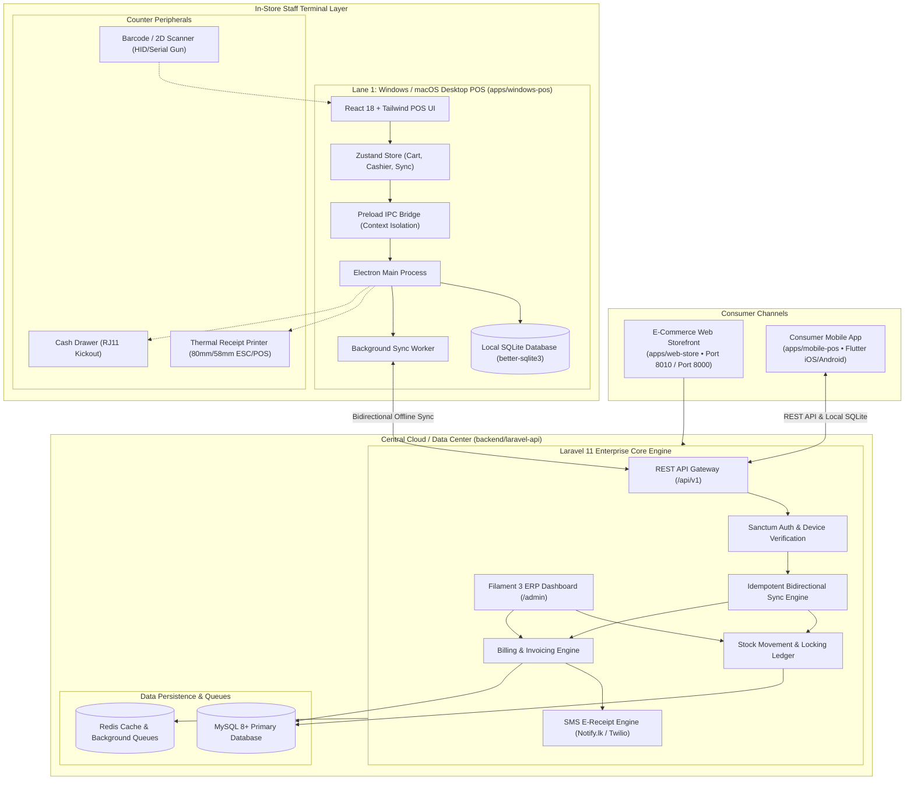

# SmartShop Enterprise Omnichannel Platform — System Architecture Specification

## 1. Architectural Overview

SmartShop is an **enterprise-grade, distributed retail & e-commerce platform** engineered for high-end multi-department retail enterprises. The platform is designed around four primary components:

1. **Consumer Mobile Shopping App (Flutter iOS/Android)**: Editorial lifestyle mobile store with catalog discovery, department filters, variant selectors, interactive bag, online card/COD checkout, and verified digital SMS receipts.
2. **Dedicated In-Store Cashier POS (Electron Windows/Mac)**: High-speed counter checkout terminal for retail cashiers, supporting barcode guns, thermal receipt printers, cash drawers, staff shifts (X/Z reports), and offline SQLite WAL durability.
3. **Customizable E-Commerce Web Storefront (`apps/web-store`)**: Public e-commerce website with real-time stock availability, luxury dark branding, and online card payments.
4. **Central Cloud ERP & Core Engine (Laravel 11 + Filament v3)**: Unified cloud administrative system managing inventory ledgers, purchase orders, multi-branch operations, customer privacy, and the SMS notification engine.



---

## 2. Component Directory Structure

```text
pos/
├── apps/
│   ├── mobile-pos/        # Consumer Mobile App (Flutter iOS/Android)
│   │   ├── lib/
│   │   │   ├── screens/store/  # Consumer Home, Catalog, Bag, Checkout, Orders
│   │   │   ├── providers/      # Riverpod Cart, Catalog, Auth
│   │   │   ├── data/           # Repositories & Models
│   │   │   └── core/           # DatabaseHelper (SQLite), AppColors, AppTheme
│   │   └── test/               # Automated unit & widget tests (21/21 passing)
│   ├── web-store/         # Public E-Commerce Web Storefront (Laravel / Blade)
│   │   └── resources/views/store/ # Home, Shop, Product, Cart, Checkout
│   └── windows-pos/       # Dedicated Desktop Cashier POS (Electron / React)
│       └── src/                # Cart, Barcode gun, Thermal printer, Cashier shifts
├── backend/
│   └── laravel-api/       # Central Cloud ERP & API Engine (Laravel 11)
│       ├── app/Filament/       # Filament v3 ERP Admin Resources
│       ├── app/Http/Controllers/
│       │   ├── Api/V1/         # POS REST API & Sync endpoints
│       │   └── WebStoreController.php # Integrated Storefront & Public E-Receipts
│       ├── database/seeders/   # Multi-Vertical Lifestyle & Department Seeders
│       └── routes/             # web.php (Storefront & /receipt), api.php
└── documentation/         # System specifications, architecture, and guides
```

---

## 3. Real-Time Inventory & Concurrency Management

- **Atomic Stock Reservation**: Online orders placed via the consumer mobile app or web storefront decrement central inventory immediately.
- **In-Store Over-the-Counter Priority**: Counter cashiers on Desktop POS query real-time stock balances; if offline, local SQLite stock counts are decremented and reconciled upon reconnection with revision versioning.
- **Serial & VIN Tracking**: Tech items (IMEI/Serial) and high-value vehicles (VIN/Chassis) capture unique identifiers at point of sale, preventing duplicate warranty registrations.
- **Public Verified E-Receipts**: All sales generate a cryptographic or unique reference (`/receipt/{invoice}`) accessible publicly with customer phone privacy masking.
