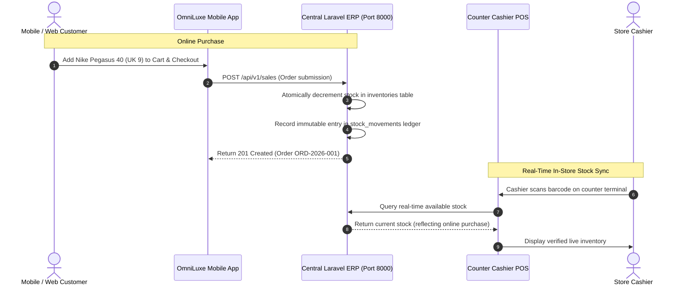
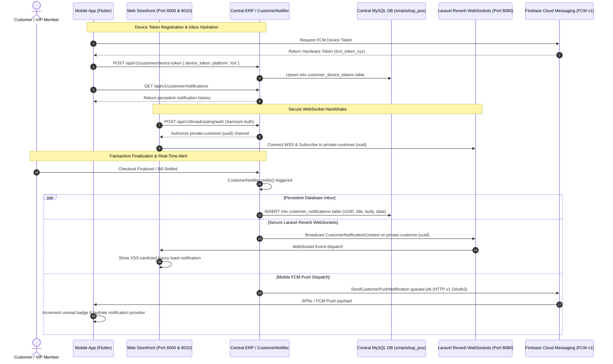

# OmniLuxe Store Enterprise Omnichannel Platform — System Architecture Specification

> **System Scope**: Multi-Platform Flagship Retail Ecosystem  
> **Platform Version**: 3.2.0  
> **Brand & Identity**: OmniLuxe Store (`omniluxe-store`)  
> **Aesthetic Theme**: Editorial Light Luxury (Ivory `#FBFBF9`, Warm Cream `#F4F2EB`, Forest Green `#233C32`, Deep Ink `#242B27`, Hairline `#E3E5DF`, Sage `#7B846D`, Champagne Gold `#C29B38`)  
> **Cart Terminology**: Standardized to **Cart** across all consumer platforms  
> **Customer Access**: Guest Explorer Mode + Multi-Step VIP Onboarding  

---

## 1. Executive Omnichannel Architecture

OmniLuxe Store connects four specialized application layers into a unified real-time retail engine:

```text
┌────────────────────────────────────────────────────────────────────────────────────────┐
│                      OMNILUXE STORE MULTI-PLATFORM ECOSYSTEM                           │
├───────────────────────────────────────────┬────────────────────────────────────────────┤
│         1. CONSUMER ONLINE CHANNELS       │         2. IN-STORE CASHIER POS TERMINAL   │
│                                           │                                            │
│  A. Web Storefront (Blade / Alpine / CSS) │  Dedicated Desktop POS (Electron / React)  │
│     • Routes: /, /shop, /login, /account  │  • Windows & macOS counter terminals       │
│     • OmniLuxe Privilege digital hub      │  • Cashier PIN quick authentication (1234) │
│     • Public verifiable SMS e-receipts    │  • Barcode scanner wedge (<60ms burst)     │
│                                           │  • Thermal ESC/POS slip (80mm / 58mm)      │
│  B. Mobile App (Flutter 3.x / Riverpod)   │  • RJ11 cash drawer kickout pulse          │
│     • iOS & Android flagship shopping     │  • Multi-lane cloud held bills             │
│     • 5-Tab luxury customer journey       │  • Offline SQLite WAL local durability     │
│     • Animated gold monogram splash       │  • Register device pairing (COUNTER-01)    │
│     • Offline order archiving in SQLite   │                                            │
├───────────────────────────────────────────┴────────────────────────────────────────────┤
│                       3. CENTRAL CLOUD ERP & BACKEND API                               │
│                       (Laravel 11 / MySQL 8 / Redis at Port 8000)                      │
│                                                                                        │
│  • RESTful API Gateway (/api/v1) with Sanctum authentication & Spatie RBAC             │
│  • Filament v3 ERP Admin Control Room (/admin) for catalog, inventory, and POs         │
│  • Real-time stock movement ledger with atomic reservations on web & POS sales         │
│  • Customer CRM, VIP loyalty ledger, and phone number privacy masking                  │
│  • Verified SMS E-Receipt Engine (Notify.lk, Twilio, Dialog, Mobitel, Mock drivers)    │
└────────────────────────────────────────────────────────────────────────────────────────┘
```

---

## 2. End-to-End System Component Diagram

```mermaid
flowchart TB
    subgraph Consumers["Customer Channels (Online Shoppers)"]
        CustomerWeb["Luxury E-Commerce Web Storefront\n(Laravel Blade • Alpine.js • Tailwind Luxe)"]
        CustomerMobile["Consumer Mobile Shopping App\n(Flutter iOS & Android • Riverpod • SQLite)"]
    end

    subgraph InStoreStaff["In-Store Staff Channels"]
        DesktopPOS["Dedicated In-Store Cashier POS\n(Electron • React 18 • TypeScript • better-sqlite3)"]
        CounterHardware["Counter Peripherals\n(Barcode Gun • 80mm Thermal Printer • RJ11 Cash Drawer)"]
        DesktopPOS --- CounterHardware
    end

    subgraph CentralEngine["Central Cloud ERP & REST Engine (Laravel 11)"]
        APIGateway["REST API Gateway (/api/v1)\nSanctum Token Auth • Device Headers"]
        FilamentAdmin["Filament v3 ERP Admin Panel (/admin)\nMulti-Store • POs • Shifts • Audit Ledgers"]
        InventoryLedger["Atomic Inventory & Movement Ledger\nReal-Time Decrement • Safety Stock • Serial Tracking"]
        BillingEngine["Billing, Invoicing & Digital E-Receipt Engine"]
        CustomerCRM["Customer CRM & VIP Loyalty Club\nPhone Masking • Points Engine (1 Pt = Rs. 10)"]
        SmsEngine["SMS E-Receipt Gateway Engine\nNotify.lk • Twilio • Dialog • Mobitel Driver"]
    end

    subgraph StorageLayer["Data Persistence & Queues"]
        MasterMySQL[("MySQL 8+ Primary Database\n25 Core Migrations • UUIDs")]
        RedisQueue[("Redis Cache, Sessions & Queues")]
    end

    CustomerWeb --> CentralEngine
    CustomerMobile <-->|REST API (/api/v1)| APIGateway
    DesktopPOS <-->|Bidirectional Offline Sync| APIGateway

    APIGateway --> BillingEngine
    APIGateway --> InventoryLedger
    APIGateway --> CustomerCRM
    FilamentAdmin --> InventoryLedger
    FilamentAdmin --> BillingEngine

    BillingEngine --> SmsEngine
    SmsEngine -.->|Verified SMS E-Receipt| Consumers
    SmsEngine -.->|SMS Bill Link| InStoreStaff

    CentralEngine --> MasterMySQL
    CentralEngine --> RedisQueue
```

---

## 3. Detailed Architecture of Each Application

### 3.1 Consumer Mobile Shopping App (`apps/mobile-pos`)
* **Technology**: Flutter 3.27+ with Dart 3.6, Flutter Riverpod state management.
* **Architecture Pattern**: Feature-driven clean architecture with reactive StateNotifiers (`CartNotifier`, `CatalogNotifier`, `AuthNotifier`, `SyncNotifier`, `NotificationNotifier`).
* **Persistence**: Local SQLite database via `sqflite` for offline catalog caching, cart state, notification history, and completed orders.
* **Key Persona**: Online department store shopper & VIP member.
* **Key Features**:
  * 5-Tab flagship shopping layout (`Home`, `Explore`, `Cart`, `Orders`, `VIP Club`).
  * Dedicated customer suite: **Profile** (`StoreProfileScreen`), **In-App Notification Center** (`StoreNotificationsScreen`), and **More Services Concierge** (`StoreMoreScreen`).
  * Live unread push notification counter badge in AppBar.
  * Hero lifestyle lookbook carousel & premier brand spotlights (Apple, Nike, Dior, Calvin Klein, Chanel, Ralph Lauren).
  * Gold-foil **OmniLuxe Privilege** digital loyalty card.
  * Instant Firebase FCM push notifications & public receipt links.

### 3.2 Flagship Web Storefront (`backend/laravel-api` & `apps/web-store`)
* **Technology**: Laravel 11 Blade templates, Alpine.js reactive components, TailwindCSS with Editorial Light Luxury styling tokens.
* **Architecture Pattern**: Server-side rendered luxury storefront with micro-reactive Alpine.js drawers (slide-over cart, login modal, search).
* **Key Persona**: Web visitors, corporate clients, and online VIP shoppers.
* **Key Features**:
  * Multi-department flagship lookbook and department filters (Fashion, Beauty, Footwear, Kids, Lifestyle Tech).
  * Customer registration with **100 Welcome Loyalty Points**.
  * Real-Time Laravel Reverb WebSocket client with authenticated private channels (`private-customer.{uuid}`) and floating toast alerts for new orders and VIP rewards.
  * Member hub at `/account` displaying order ledger and digital VIP privilege card.
  * Verifiable public e-receipt lookup at `/receipt/{invoice}` with phone number privacy protection (`077 •••• 567`).

### 3.3 Dedicated In-Store Cashier POS (`apps/windows-pos`)
* **Technology**: Electron, React 18, TypeScript, TailwindCSS, Vite.
* **Architecture Pattern**: Context-isolated dual-process architecture:
  * **Renderer Process**: High-throughput cashier UI, Zustand state store, Web Audio synthesizer chimes.
  * **Main Process**: `better-sqlite3` native database, raw ESC/POS thermal raster driver, USB/Bluetooth barcode scanner wedge listener, serial scale parser.
* **Key Persona**: Store cashiers and counter supervisors.
* **Key Features**:
  * Numeric PIN pad authentication (`1234`) tied to counter device codes (`COUNTER-01`).
  * Instant sub-60ms barcode gun input detection.
  * ESC/POS 80mm & 58mm thermal receipts with warranty serial numbers.
  * RJ11 cash drawer kickout pulse on cash finalization.
  * Multi-lane cloud held bills for high-traffic queues.

### 3.4 Central ERP & REST API Engine (`backend/laravel-api`)
* **Technology**: Laravel 11, Filament v3 Admin Panel, MySQL 8, Redis, Spatie Permissions.
* **Architecture Pattern**: Domain-driven service layer with immutable audit ledgers.
* **Key Persona**: Super Admins (`admin@omniluxe.store`), Store Managers (`manager@smartshop.com`), and System Auditors.
* **Key Features**:
  * Complete control room at `http://127.0.0.1:8000/admin`.
  * Multi-store catalog and serialized inventory ledger (`stock_movements`).
  * Atomic inventory reservation guaranteeing zero overselling across web, mobile, and counter channels.
  * Pluggable SMS gateway dispatching tamper-evident digital bill links.

---

## 4. Omnichannel Data Flow: Real-Time Stock Sync



---

## 5. Omnichannel Push Notifications & Laravel Reverb Real-Time WebSockets

OmniLuxe Store incorporates a secure, enterprise-grade real-time messaging pipeline built on **Laravel Reverb WebSockets** (replacing external proprietary third-party brokers like Pusher) alongside **Firebase Cloud Messaging (FCM v1)** and an atomic central database inbox:



### Component Roles & WebSocket Channels:
1. **`CustomerNotifier` (Central Domain Service)**: Unified entry point that guarantees all customer communications simultaneously persist into the central `customer_notifications` database table, broadcast instantly over Laravel Reverb private channels, and queue for Firebase FCM v1 mobile delivery.
2. **`Laravel Reverb` (High-Throughput WebSocket Server)**: Native, high-performance WebSocket server running at `ws://127.0.0.1:8080` (or `wss://` in production) speaking the Pusher protocol without third-party external dependencies or SaaS subscription limits.
3. **Channel Security & Authorization (`routes/channels.php`)**:
   - `private-customer.{customerUuid}`: Strictly isolated to the authenticated customer account matching `auth()->user()->customerProfile->uuid` or `customer.user_id`. Outside consumers cannot intercept other customers' orders or VIP alerts.
   - `private-store.{storeUuid}.operations`: Strictly restricted to authenticated staff with `isStaff()` role. In-store cashiers receive counter sync events; zero leakage to consumer channels.
   - `catalog` (Public): Dispatches sanitized product availability band changes (`in_stock`, `low_stock`, `out_of_stock`). Never exposes supplier prices, margin figures, or exact quantity numbers.
   - `promotions` (Public): Dispatches curated brand collection drops and seasonal lookbook releases.
4. **`CustomerNotification` & `CustomerDeviceToken` Models**: Central persistence engine linking hardware tokens and notification inboxes with read-tracking (`read_at`), deep linking metadata, and automatic dead-token pruning.
5. **Mobile Push & Notification Service (`apps/mobile-pos`)**: Riverpod-driven `NotificationService` and `NotificationNotifier` that fetch persistent inboxes from `GET /api/v1/customer/notifications`, sync FCM tokens with `POST /api/v1/customer/device-token`, and synchronize read status via `POST /api/v1/customer/notifications/{uuid}/read`.
6. **Web Storefront Toast Client (`layout.blade.php`)**: Subscribes to Reverb WebSockets and presents micro-animated editorial toasts using secure DOM element text injection (`textContent`) to prevent XSS.

---

## 6. Enterprise Security Boundary & Single Unified Database Architecture

```text
┌────────────────────────────────────────────────────────────────────────────────────────┐
│                      ZERO-LEAKAGE ENTERPRISE CHANNEL ISOLATION                         │
├───────────────────────────────────────────┬────────────────────────────────────────────┤
│       1. EXTERNAL / CONSUMER ZONE         │        2. INTERNAL OPERATIONS ZONE         │
│  (Pure Consumer Shopping — Zero Leakage)  │   (Restricted to Physical Store & Staff)   │
│                                           │                                            │
│  • Public Web Storefront & Flutter Mobile │  • Dedicated Desktop POS (apps/windows-pos)│
│  • Sanitized public API endpoints only    │  • Cashier PIN quick sign-in (1234)        │
│  • ZERO visibility of internal operations │  • Counter register codes (COUNTER-01)     │
│  • ZERO staff terminal or cashier access  │  • Hardware pairing: ESC/POS, barcode wedge│
│  • ZERO exposure of ERP or admin URLs     │  • Cash drawer kicks, X-Report & Z-Report  │
│  • Phone number masking (077 •••• 567)    │  • Multi-lane held bills cloud sync        │
├───────────────────────────────────────────┴────────────────────────────────────────────┤
│                       3. RESTRICTED ERP & CONTROL ROOM                                 │
│                       (Laravel 11 / Filament v3 at /admin)                             │
│                                                                                        │
│  • Accessible strictly to authenticated Super Admins & Store Managers via RBAC         │
│  • Supplier relations, purchase orders, refunds approval, and cash drawer reconciles   │
│  • Isolated from public discovery (no links from consumer storefront or mobile app)    │
├────────────────────────────────────────────────────────────────────────────────────────┤
│                       4. SINGLE UNIFIED DATABASE OF TRUTH                              │
│                       (Central MySQL 8 — 25 Migrations)                                │
│                                                                                        │
│  • Unified Single Relational Database: Eliminates multi-database sync drift            │
│  • Clean relational schema shared across all layers:                                   │
│    - products, categories, brands, inventories, stock_movements (atomic ledgers)       │
│    - sales, sale_items, payments, customers, loyalty_transactions                      │
│    - cash_sessions, devices, stores, sync_revisions                                    │
│  • Strict Data Projection: Public customer APIs only return sanitized retail data;     │
│    cost prices, supplier records, margins, and audit ledgers never cross boundary      │
└────────────────────────────────────────────────────────────────────────────────────────┘
```

### Architectural Principles:

1. **Zero Public Leakage (Defense-in-Depth)**:
   - Outsiders and consumers browsing the web store or mobile shopping app are strictly isolated from the internal company structure.
   - Cashier register access, hardware pairing (thermal printers, barcode scanners, cash drawers), and staff terminals are physically and logically segregated to the dedicated in-store desktop POS (`apps/windows-pos`).
   - The central ERP administration portal (`/admin`) has zero public hyperlinks and is protected by Spatie RBAC, session timeouts, and IP whitelisting capabilities.

2. **Single Database as the Master Source of Truth (Zero Drift Across Web & Store)**:
   - Rather than fragmenting into divergent databases that risk stock sync errors and catalog drift, **all online channels and ERP instances operate against one identical MySQL relational database (`smartshop_pos`)**:
     - Both the central ERP API host (`http://127.0.0.1:8000`) and the dedicated web store application (`http://127.0.0.1:8010`, `apps/web-store`) write to and read from the exact same MySQL tables.
     - Products (Apple, Nike, Dior, Calvin Klein, etc.), categories, brands, inventory balances, customer accounts, and sales transactions are 100% unified.
     - When a customer purchases on `apps/web-store`, an in-store cashier completes a sale on `apps/windows-pos`, or an order is submitted via the mobile app, stock decrements atomically in the same `inventories` and `stock_movements` ledger tables.
   - Offline SQLite instances on the Desktop POS and Mobile App exist strictly as **ephemeral, read-through / write-ahead offline caches** for resilience during connectivity drops, synchronizing bidirectionally back into the master MySQL database via versioned revision logs (`sync_revisions`).

3. **Data Sanitization & Customer Privacy**:
   - Customer phone numbers are masked on public e-receipt verification links (`077 •••• 567`).
   - Consumer REST endpoints (`/api/v1/catalog`, `/api/v1/customer/*`) project sanitized views that strip all internal procurement metadata (`cost_price`, `supplier_id`, internal accounting codes).
