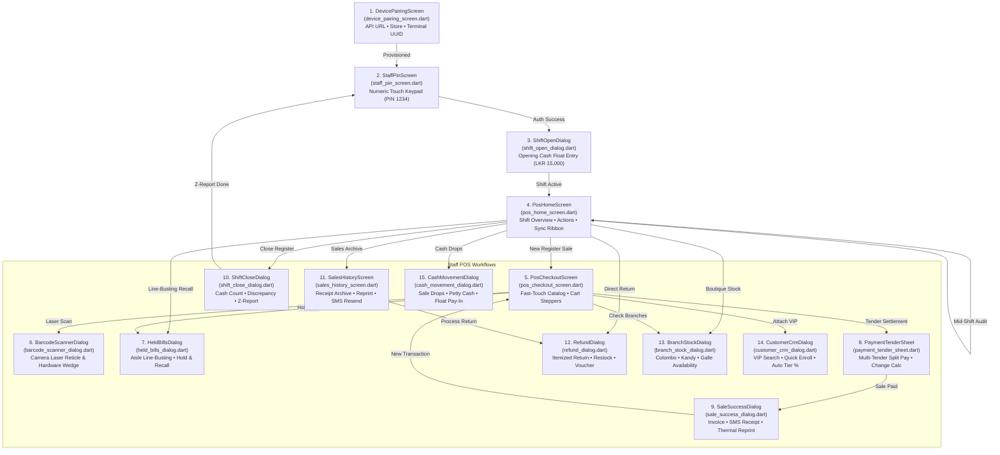

# OmniLuxe Store — Flutter Mobile Apps Screens Catalog & Architecture

> **Applications**: 
> 1. **Consumer Mobile Shopping App**: `apps/mobile-pos` (Light Editorial Luxury)
> 2. **Handheld Staff Mobile POS**: `apps/flutter-mobile-pos` (High-Contrast Dark Luxury Roaming Terminal)  
> **Target Framework**: Flutter 3.27+ / Dart 3.6+  
> **State Management**: Flutter Riverpod (`StateNotifierProvider`)  
> **Local Persistence**: SQLite (`sqflite` with WAL Durability)  
> **Cart Terminology**: Standardized to **Cart** across all consumer touchpoints  
> **Document Version**: 3.5.0  

---

# PART 1: Consumer Mobile Shopping App (`apps/mobile-pos`)

## 1. Application Screen Hierarchy & Navigation Flow

The mobile app implements a clean, nested navigation hierarchy centered around an animated splash launcher, guest explorer capabilities, multi-step customer authentication, a persistent 5-tab customer experience, and dedicated customer care screens:

```mermaid
flowchart TD
    Splash["1. SplashScreen\n(screens/splash/splash_screen.dart)\nAnimated Gold Monogram & Sync"]

    MainShell["2. StoreMainScreen\n(screens/store/store_main_screen.dart)\n5-Tab Bottom Navigation Shell"]

    Splash -->|Auto Transition (2.4s)| MainShell

    subgraph TabNavigation["5 Core Customer Tabs (Light Editorial)"]
        Tab1["3. StoreHomeScreen\n(screens/store/store_home_screen.dart)\nHero Lookbook • Brands • Departments"]
        Tab2["4. StoreCatalogScreen (Explore)\n(screens/store/store_catalog_screen.dart)\nSearch • Filter Chips • Grid"]
        Tab3["5. StoreCartScreen (Cart)\n(screens/store/store_cart_screen.dart)\nCart Steppers • Summary • Subtotal"]
        Tab4["6. StoreOrdersScreen (Orders)\n(screens/store/store_orders_screen.dart)\nOrder Ledger • Status Badges"]
        Tab5["7. StoreMemberScreen (VIP Club & Guest Mode)\n(screens/store/store_member_screen.dart)\nGuest Overview • Digital Privilege Card"]
    end

    MainShell --> Tab1
    MainShell --> Tab2
    MainShell --> Tab3
    MainShell --> Tab4
    MainShell --> Tab5

    subgraph CustomerCareAndPush["Customer Care, Notifications & Settings"]
        NotifScreen["8. StoreNotificationsScreen\n(screens/store/store_notifications_screen.dart)\nFirebase FCM Push History & Unread Filter"]
        ProfileScreen["9. StoreProfileScreen\n(screens/store/store_profile_screen.dart)\nProfile, Verified Mobile & Notification Toggles"]
        MoreScreen["10. StoreMoreScreen\n(screens/store/store_more_screen.dart)\nBoutique Locator, Warranty & Customer Concierge"]
    end

    Tab1 -.->|Bell Icon| NotifScreen
    Tab1 -.->|Menu Icon| MoreScreen
    Tab5 -.->|Gear Icon| ProfileScreen
    Tab5 -.->|Bell Icon| NotifScreen
    MoreScreen -.->|Profile Link| ProfileScreen
    MoreScreen -.->|Push Alerts| NotifScreen

    subgraph AuthAndGuest["Guest Mode & Multi-Step Authentication"]
        AuthSteps["11. StoreAuthStepsScreen\n(screens/store/store_auth_steps_screen.dart)\nStep 1: Contact / Guest Option\nStep 2: Password & VIP Enrollment\nStep 3: Privilege Card Issued"]
    end

    Tab5 -.->|Tap Sign In / Register| AuthSteps
    Tab3 -.->|Guest Mode or Sign In| AuthSteps
    ProfileScreen -.->|Sign In Prompt| AuthSteps

    subgraph DetailAndCheckout["Detail & Checkout Modals"]
        Detail["12. ProductDetailScreen\n(screens/store/product_detail_screen.dart)\nGallery • Specs • Warranty • Add to Cart"]
        Checkout["13. StoreCheckoutScreen\n(screens/store/store_checkout_screen.dart)\nGuest Checkout • Delivery • Payment"]
        OrderConfirm["14. OrderConfirmationScreen\n(screens/store/order_confirmation_screen.dart)\nAnimated Check • SMS Link • Receipt URL"]
        Receipt["15. ReceiptScreen\n(screens/receipt/receipt_screen.dart)\nThermal Receipt Slip & Warranty Details"]
    end

    Tab1 -.->|Tap Curated Item| Detail
    Tab2 -.->|Tap Product Card| Detail
    Detail -.->|Add to Cart| Tab3
    Tab3 -.->|Proceed to Checkout| Checkout
    Checkout -.->|Place Order (Guest or Member)| OrderConfirm
    OrderConfirm -.->|View Receipt| Receipt
    Tab4 -.->|Tap Order| Receipt

    subgraph StaffAndSettings["In-Store Staff Operational Counter Layer (Dedicated Desktop POS Only)"]
        Settings["16. SettingsScreen\n(Hardware config & ESC/POS pairing)"]
        Pairing["17. PairingScreen\n(Counter register UUID)"]
        StaffLogin["18. LoginScreen\n(Cashier PIN 1234)"]
        StaffPOS["19. PosScreen\n(Desktop counter terminal)"]
        CashSession["20. CashSessionDialog\n(Shift opening & X/Z reports)"]
        BarcodeScanner["21. BarcodeScannerDialog\n(High-speed barcode scanner)"]
        PaymentDialog["22. PaymentDialog\n(Cashier tender settlement)"]
    end

    StaffLogin -.->|Auth Success| StaffPOS
    StaffPOS -.->|Shift Management| CashSession
    StaffPOS -.->|Hardware Wedge| BarcodeScanner
    StaffPOS -.->|Tender Settlement| PaymentDialog
    Settings -.->|Device UUID| Pairing
```

---

## 2. Complete Screen Catalog Inventory

### Screen 1: Splash Screen
- **Class & File**: [`SplashScreen`](file:///Users/chanaka/Desktop/projects/pos/apps/mobile-pos/lib/screens/splash/splash_screen.dart) in `lib/screens/splash/splash_screen.dart`
- **Design Theme**: Clean ivory canvas (`#FBFBF9`), signature forest green medallion with champagne gold monogram `O`, and deep ink typography.
- **Key UI Components**:
  - Pulsing medallion with monogram `O`.
  - Elegant serif title `OMNILUXE STORE` with letter-spacing `4.0`.
  - Subtitle badge: `COLOMBO 03 FLAGSHIP • SYNCED WITH CENTRAL OMNILUXE ERP`.
  - Forest green progress indicator.
- **State Management**: Listens to `syncProvider` to ensure catalog checkpoint is ready.
- **Actions**: Auto-advances to `StoreMainScreen` after 2400ms duration.

---

### Screen 2: Flagship Main Shell (5-Tab Container)
- **Class & File**: [`StoreMainScreen`](file:///Users/chanaka/Desktop/projects/pos/apps/mobile-pos/lib/screens/store/store_main_screen.dart) in `lib/screens/store/store_main_screen.dart`
- **Design Theme**: Clean white paper bottom bar (`#FFFFFF`) with `#E3E5DF` hairline border, deep forest green active indicator, and sage inactive icons.
- **5 Navigation Items**:
  1. `Home` (`Icons.home_outlined` / `Icons.home`)
  2. `Explore` (`Icons.explore_outlined` / `Icons.explore`)
  3. `Cart` (`Icons.shopping_cart_outlined` / `Icons.shopping_cart` + dynamic badge count)
  4. `Orders` (`Icons.receipt_long_outlined` / `Icons.receipt_long`)
  5. `VIP Club` (`Icons.card_membership_outlined` / `Icons.card_membership`)

---

### Screen 3: Home Lookbook Screen
- **Class & File**: [`StoreHomeScreen`](file:///Users/chanaka/Desktop/projects/pos/apps/mobile-pos/lib/screens/store/store_home_screen.dart) in `lib/screens/store/store_home_screen.dart`
- **Key UI Components**:
  - Top AppBar with:
    - Notification Bell with unread badge counter (`unreadNotificationCountProvider`).
    - Shopping Cart shortcut.
    - More & Services menu button.
  - Hero Lookbook Banner in Deep Forest Green (`#233C32`) with gold tag `FLAGSHIP SHOWCASE 2026`.
  - Tagline: `Apparel • Footwear • Beauty & Fragrance • Tech`.
  - Horizontal brand carousel: `Studio Ceylon`, `Ralph Lauren`, `Tommy Hilfiger`, `Calvin Klein`, `Nike`, `Zara`, `Dior`, `Apple`, `Adidas`.
  - 5 Department cards:
    - *Designer Fashion* (Studio Ceylon, Zara, Polo)
    - *Footwear & Leather* (Nike, Adidas, Clarks)
    - *Perfumes & Beauty* (Dior, Calvin Klein, Chanel)
    - *Kids & Teens* (Polo Kids, Toys & Apparel)
    - *Smartphones & Lifestyle Tech* (Apple, Samsung, Sony Audio)

---

### Screen 4: Store Catalog & Explore Screen
- **Class & File**: [`StoreCatalogScreen`](file:///Users/chanaka/Desktop/projects/pos/apps/mobile-pos/lib/screens/store/store_catalog_screen.dart) in `lib/screens/store/store_catalog_screen.dart`
- **Key UI Components**:
  - Search bar with live debounce.
  - Category filter chips (All Collections, Designer Fashion, Footwear, Perfumery, Kids, Tech).
  - Product cards on white paper with hairline borders, stock status, official warranty chip, and 1-tap `Add to Cart` button.

---

### Screen 5: Shopping Cart Screen
- **Class & File**: [`StoreCartScreen`](file:///Users/chanaka/Desktop/projects/pos/apps/mobile-pos/lib/screens/store/store_cart_screen.dart) in `lib/screens/store/store_cart_screen.dart`
- **Key UI Components**:
  - App bar titled `SHOPPING CART` with item counter and `Clear Shopping Cart` option.
  - Item tiles: thumbnail, product name, unit price, quantity steppers (`-`, qty, `+`), and delete icon.
  - Order summary card on warm cream (`#F4F2EB`): subtotal, white-glove packaging, grand total.
  - Primary button: `PROCEED TO SECURE CHECKOUT` in signature forest green.

---

### Screen 6: Customer Orders Ledger Screen
- **Class & File**: [`StoreOrdersScreen`](file:///Users/chanaka/Desktop/projects/pos/apps/mobile-pos/lib/screens/store/store_orders_screen.dart) in `lib/screens/store/store_orders_screen.dart`
- **Key UI Components**:
  - Order cards with invoice reference (e.g., `ORD-2026-XXXX`), timestamp, item summary, total amount, and payment status badge (`PAID`).
  - 1-tap navigation to view digital thermal receipt slip.

---

### Screen 7: VIP Club & Guest Mode Screen
- **Class & File**: [`StoreMemberScreen`](file:///Users/chanaka/Desktop/projects/pos/apps/mobile-pos/lib/screens/store/store_member_screen.dart) in `lib/screens/store/store_member_screen.dart`
- **Key UI Components**:
  - **Guest Mode State**: Guest Explorer card with quick explanation: "Browsing with instant checkout & SMS verification".
  - Quick CTA: `Sign In or Register with Steps (+100 Pts)` (opens `StoreAuthStepsScreen`).
  - Instant demo login button: `Instant Demo: Dulantha (VIP Gold Member)`.
  - **Member State**: Deep Forest Green Digital Privilege Card (`#233C32` gradient) with embossed gold monogram `O`, member tier (`GOLD VIP`), cardholder name, club loyalty points, and store credit limit.
  - Privileges breakdown card and Account Credentials card.

---

### Screen 8: Push Notifications Center Screen
- **Class & File**: [`StoreNotificationsScreen`](file:///Users/chanaka/Desktop/projects/pos/apps/mobile-pos/lib/screens/store/store_notifications_screen.dart) in `lib/screens/store/store_notifications_screen.dart`
- **Key UI Components**:
  - Firebase FCM active status indicator banner with unread counter.
  - Filter chips: `All Alerts`, `Orders`, `VIP Club`, `Promotions`.
  - Notification tiles with category icons, timestamp, unread indicator dot, and tap-to-read interaction.
  - Header action: `Mark All Read`.

---

### Screen 9: Customer Profile & Settings Screen
- **Class & File**: [`StoreProfileScreen`](file:///Users/chanaka/Desktop/projects/pos/apps/mobile-pos/lib/screens/store/store_profile_screen.dart) in `lib/screens/store/store_profile_screen.dart`
- **Key UI Components**:
  - Cardholder avatar and tier badge.
  - Verified mobile phone number for instant tamper-evident SMS receipts.
  - Saved delivery street addresses.
  - Push Notification toggles:
    - *FCM Order Status Alerts*
    - *VIP Collection Drops & Promos*
    - *Tamper-Evident SMS Receipts*
  - Sign Out action.

---

### Screen 10: More & Services Menu Screen
- **Class & File**: [`StoreMoreScreen`](file:///Users/chanaka/Desktop/projects/pos/apps/mobile-pos/lib/screens/store/store_more_screen.dart) in `lib/screens/store/store_more_screen.dart`
- **Key UI Components**:
  - Profile header card with direct link to `StoreProfileScreen`.
  - Customer Services group:
    - Push Notifications Center (with live unread badge).
    - Find a Boutique (Colombo 03 Flagship, Kandy City Centre, Galle Fort).
    - Warranty & 14-Day Exchange Policy dialog.
    - Customer Concierge & Support WhatsApp direct link.
  - Privilege & Policies group:
    - Privilege Club Tiers & Rewards (Silver, Gold, Platinum VIP benefits).
    - Customer Privacy & Data Protection (Phone masking, zero trackers, verified push delivery).
    - 100% Authenticity Guarantee (Direct brand distributor sourcing).

---

### Screen 11: Multi-Step Login & Registration Screen
- **Class & File**: [`StoreAuthStepsScreen`](file:///Users/chanaka/Desktop/projects/pos/apps/mobile-pos/lib/screens/store/store_auth_steps_screen.dart) in `lib/screens/store/store_auth_steps_screen.dart`
- **Features**:
  - Visual Step Progress Tracker: `1. Contact` -> `2. Security & VIP` -> `3. VIP Ready`.
  - Mode toggle: Register vs Sign In.
  - **Step 1**: Email / Mobile input + prominent **"Continue Exploring as Guest"** bypass button.
  - **Step 2**: Password, Full Name, and VIP Club Enrollment opt-in (+100 Welcome Points).
  - **Step 3**: Confirmation banner and instant digital loyalty card issuance.

---

### Screen 12: Product Detail Screen
- **Class & File**: [`ProductDetailScreen`](file:///Users/chanaka/Desktop/projects/pos/apps/mobile-pos/lib/screens/store/product_detail_screen.dart) in `lib/screens/store/product_detail_screen.dart`
- **Key UI Components**: Warm cream image gallery, brand tags, price, warranty badge, serial tracking indicators, sticky `Add to Cart` and `Buy Now` buttons.

---

### Screen 13: Secure Checkout Screen
- **Class & File**: [`StoreCheckoutScreen`](file:///Users/chanaka/Desktop/projects/pos/apps/mobile-pos/lib/screens/store/store_checkout_screen.dart) in `lib/screens/store/store_checkout_screen.dart`
- **Key UI Components**: Guest checkout banner, recipient details, fulfillment choice (Delivery vs Boutique Pickup), payment tender (Card vs Cash on Delivery), and forest green primary CTA button.

---

### Screen 14: Order Confirmation Screen
- **Class & File**: [`OrderConfirmationScreen`](file:///Users/chanaka/Desktop/projects/pos/apps/mobile-pos/lib/screens/store/order_confirmation_screen.dart) in `lib/screens/store/order_confirmation_screen.dart`
- **Key UI Components**: Animated checkmark, order reference number, verified SMS receipt dispatched notice, and direct link to web receipt.

---

# PART 2: Handheld Staff Mobile POS (`apps/flutter-mobile-pos`)

> **Application**: OmniLuxe Handheld Staff POS (`apps/flutter-mobile-pos`)  
> **Target Framework**: Flutter 3.27+ / Dart 3.6+  
> **State Management**: Flutter Riverpod (`StateNotifierProvider`)  
> **Target Hardware**: Handheld Rugged Mobile Terminals, Tablets, Smartphones  
> **Design Theme**: High-Contrast Dark Luxury POS Terminal (Background `#111413`, Surface `#19201C`, Card `#1F2722`, Border `#2E3B34`, Accent Amber `#F59E0B`, Primary Gold `#C29B38`, Accent Green `#10B981`)  
> **Peripherals**: Built-in Camera Laser Viewfinder (`mobile_scanner`), Bluetooth ESC/POS Printers (58mm/80mm), Bluetooth Barcode Wedge, Physical Cash Drawer RJ11 / Mobile Cash Belt  
> **Offline Durability**: Local SQLite WAL Database (`PosDatabaseService`) + Delta Sync Queue (`PosSyncProvider`)  



---

### Screen 15: Device Pairing & Terminal Provisioning Screen
- **Class & File**: [`DevicePairingScreen`](file:///Users/chanaka/Desktop/projects/pos/apps/flutter-mobile-pos/lib/screens/device_pairing_screen.dart) in `lib/screens/device_pairing_screen.dart`
- **Purpose**: First-run bootstrap screen binding the physical handheld terminal to the central ERP backend.
- **Key UI Components**:
  - Central ERP API Host URL input field (defaults to `http://127.0.0.1:8000`).
  - Retail Store Outlet selector dropdown (`STORE-001 Colombo Flagship`, `STORE-002 Kandy Galleria`, `STORE-003 Galle Fort`).
  - Terminal Device Identifier input (e.g. `ROAMING-01`, `MOBILE-02`).
  - Live "TEST ERP CONNECTION" ping button verifying health and latency.
  - "CONFIRM & PAIR TERMINAL" persistent action button storing config in `SharedPreferences`.

---

### Screen 16: Cashier Staff PIN Authentication Pad
- **Class & File**: [`StaffPinScreen`](file:///Users/chanaka/Desktop/projects/pos/apps/flutter-mobile-pos/lib/screens/staff_pin_screen.dart) in `lib/screens/staff_pin_screen.dart`
- **Purpose**: Rapid cashier authentication, locking, and multi-staff terminal switching.
- **Key UI Components**:
  - Cashier selection carousel (Cashier 01, Cashier 02, Store Manager).
  - High-contrast PIN dot indicators (`••••`).
  - Tactile 12-key numeric touch keypad (`1` through `9`, `C` clear, `0`, `⌫` backspace) with audio/haptic click feedback.
  - Quick terminal unpair button with supervisor confirmation.
  - Automated authentication logic validating against local and remote credentials (default PIN: `1234`).

---

### Screen 17: Shift Opening Cash Float Modal
- **Class & File**: [`ShiftOpenDialog`](file:///Users/chanaka/Desktop/projects/pos/apps/flutter-mobile-pos/lib/screens/shift_open_dialog.dart) in `lib/screens/shift_open_dialog.dart`
- **Purpose**: Compulsory cash drawer float initialization required before opening a cashier shift.
- **Key UI Components**:
  - Floating dialog with cash drawer icon and opening float title.
  - Numeric currency input (`LKR 15,000.00`).
  - Rapid preset chips: `LKR 10,000`, `LKR 15,000`, `LKR 20,000`, `LKR 25,000`.
  - Shift notes field (e.g. "Morning roaming register opening").
  - "OPEN CASHIER SHIFT" primary CTA invoking `POST /api/v1/cash-sessions/open`.

---

### Screen 18: Handheld POS Cashier Hub
- **Class & File**: [`PosHomeScreen`](file:///Users/chanaka/Desktop/projects/pos/apps/flutter-mobile-pos/lib/screens/pos_home_screen.dart) in `lib/screens/pos_home_screen.dart`
- **Purpose**: Cashier home dashboard displaying active shift telemetry, connection state, and quick workflow launchers.
- **Key UI Components**:
  - Top persistent [`SyncStatusRibbon`](file:///Users/chanaka/Desktop/projects/pos/apps/flutter-mobile-pos/lib/screens/sync_status_ribbon.dart) indicating real-time sync state.
  - Active Cashier identity bar with store name, device UUID, and 1-tap lock button.
  - Active Shift card highlighting Opening Float (`LKR 15,000.00`) and "Shift Active" badge.
  - Workflow Cards:
    - **Register Checkout & Barcode Scanner**: Opens full touch catalog and cart.
    - **Multi-Lane Line-Busting & Held Bills**: Opens held bills inquiry.
    - **Mid-Shift X-Report & Cash Audit**: Opens live sales audit bottom sheet with thermal print button.
    - **Close Register Shift (Z-Report)**: Launches shift closeout and cash reconciliation dialog.
  - Connected ERP footer showing active API address and version.

---

### Screen 19: Full-Touch Register Checkout & Catalog Screen
- **Class & File**: [`PosCheckoutScreen`](file:///Users/chanaka/Desktop/projects/pos/apps/flutter-mobile-pos/lib/screens/pos_checkout_screen.dart) in `lib/screens/pos_checkout_screen.dart`
- **Purpose**: High-velocity in-aisle item addition, quantity adjustments, and live cart management.
- **Key UI Components**:
  - Department horizontal category filter tabs: *All Items, Smartphones & Tech, Designer Fashion, Footwear, Fragrances, Kids*.
  - Search-as-you-type input with instant instant SKU / name matching.
  - Touch catalog grid displaying product cards with stock indicator chips, brand badges, and prices.
  - Floating optical camera barcode scanner action button.
  - Slide-up interactive Cart Drawer showing line items, quantity steppers (`-`, `+`, trash), line item subtotal, order-level discount badge, and attached VIP customer card.
  - Dual action bottom bar: "HOLD BILL" (line-busting) and "CHARGE LKR XXX,XXX" (proceed to tender).

---

### Screen 20: Optical Laser Barcode Scanner Dialog
- **Class & File**: [`BarcodeScannerDialog`](file:///Users/chanaka/Desktop/projects/pos/apps/flutter-mobile-pos/lib/screens/barcode_scanner_dialog.dart) in `lib/screens/barcode_scanner_dialog.dart`
- **Purpose**: Continuous camera laser scanning viewfinder and simulated hardware wedge listener.
- **Key UI Components**:
  - Full-screen or modal live camera viewfinder powered by `mobile_scanner`.
  - High-contrast animated emerald laser beam scanning animation and corner reticle guides.
  - Torch / flashlight toggle and front/back camera switcher.
  - Quick-test barcode chip bar allowing instant testing without physical barcodes (`445566 iPhone 16`, `556677 Nike Air Max`, `667788 Chanel No.5`).
  - Haptic feedback and automatic line-item increment on barcode decode.

---

### Screen 21: Line-Busting & Multi-Lane Held Bills Dialog
- **Class & File**: [`HeldBillsDialog`](file:///Users/chanaka/Desktop/projects/pos/apps/flutter-mobile-pos/lib/screens/held_bills_dialog.dart) in `lib/screens/held_bills_dialog.dart`
- **Purpose**: Roaming in-aisle pre-scanning, allowing staff to bag items, hold the bill with a token, and let customers pay at counter or vice-versa.
- **Key UI Components**:
  - Filter tabs: *Active Held Bills* and *Held on This Device*.
  - Held order cards displaying 6-character token (`HOLD-XXXXXX`), customer name, item count, total payable, and elapsed hold time.
  - 1-tap "RECALL TO REGISTER" action button restoring items and customer data into active cart.
  - Manual hold note input modal for custom customer tags.

---

### Screen 22: Multi-Tender Split Payment Modal Sheet
- **Class & File**: [`PaymentTenderSheet`](file:///Users/chanaka/Desktop/projects/pos/apps/flutter-mobile-pos/lib/screens/payment_tender_sheet.dart) in `lib/screens/payment_tender_sheet.dart`
- **Purpose**: Flexible split payment processing across cash, card, gift cards, and QR.
- **Key UI Components**:
  - Payment method selector tabs:
    - **CASH**: Quick denomination buttons (`Exact`, `+1,000`, `+5,000`, `10,000`), numeric keypad, and live change due calculation.
    - **CARD / mPOS**: Terminal reference input, bank authorization code, card brand selector (Visa, Mastercard, Amex).
    - **VIP GIFT CARD**: Code scanner/input (`GC-XXXX-XXXX-XXXX`), instant live balance verification via `/api/v1/gift-cards/verify`, and partial/full store credit application.
    - **LANKAQR**: Dynamic EMVCo QR code generator with 1-tap test settlement.
  - Paid tenders breakdown list with delete buttons for partial tenders.
  - Balance Remaining vs Change Due highlight card.
  - "COMPLETE SALE" confirmation button triggering transaction settlement.

---

### Screen 23: Sale Success & Celebration Dialog
- **Class & File**: [`SaleSuccessDialog`](file:///Users/chanaka/Desktop/projects/pos/apps/flutter-mobile-pos/lib/screens/sale_success_dialog.dart) in `lib/screens/sale_success_dialog.dart`
- **Purpose**: Transaction confirmation, cash change reminder, thermal printing, and SMS dispatch.
- **Key UI Components**:
  - Animated emerald checkmark medallion.
  - Official invoice reference header (`INV-XXXXXX`).
  - Prominent Cash Change Due banner (`CHANGE DUE: LKR X,XXX.00`).
  - Tenders summary breakdown (e.g. Cash: LKR 100,000, Card: LKR 300,000).
  - VIP Loyalty Points earned badge (`+400 VIP Points Earned`).
  - SMS E-Receipt mobile input with 1-tap resend.
  - "PRINT THERMAL RECEIPT" button queuing ESC/POS binary slip to portable printer.
  - "START NEW SALE" primary action resetting register state.

---

### Screen 24: Real-Time Sync Status Ribbon
- **Class & File**: [`SyncStatusRibbon`](file:///Users/chanaka/Desktop/projects/pos/apps/flutter-mobile-pos/lib/screens/sync_status_ribbon.dart) in `lib/screens/sync_status_ribbon.dart`
- **Purpose**: Persistent non-intrusive status bar informing cashiers of cloud connectivity and pending offline queue.
- **Key UI Components**:
  - Green state: `CLOUD SYNC ACTIVE` when online and queue is empty.
  - Amber state: `OFFLINE - X SALES PENDING SYNC` when disconnected.
  - Blue state: `SYNCING X SALES...` during active batch push.
  - 1-tap manual "SYNC NOW" action button triggering immediate flush.

---

### Screen 25: Shift Closeout & Z-Report Reconciliation Modal
- **Class & File**: [`ShiftCloseDialog`](file:///Users/chanaka/Desktop/projects/pos/apps/flutter-mobile-pos/lib/screens/shift_close_dialog.dart) in `lib/screens/shift_close_dialog.dart`
- **Purpose**: End-of-shift cash drawer count, variance calculation, and official closing Z-Report issuance.
- **Key UI Components**:
  - Financial Summary Card: Opening float, cash sales, card sales, gift card sales, total bills, and Expected Drawer Cash.
  - Physical Cash Count input field with quick addition chips (`Exact`, `+1,000`, `+5,000`).
  - Live Discrepancy indicator badge:
    - `BALANCED (LKR 0.00)` in green.
    - `OVER (+LKR XXX.00)` in amber.
    - `SHORT (-LKR XXX.00)` in red.
  - Supervisor authorization / closing notes text field.
  - "CONFIRM COUNT & CLOSE REGISTER" action button calling `/api/v1/cash-sessions/close`.
  - Post-closeout Z-Report success summary card with thermal slip printing and "LOCK TERMINAL" button.

---

### Screen 26: Sales History & Receipt Reprint Screen
- **Class & File**: [`SalesHistoryScreen`](file:///Users/chanaka/Desktop/projects/pos/apps/flutter-mobile-pos/lib/screens/sales_history_screen.dart) in `lib/screens/sales_history_screen.dart`
- **Purpose**: Unified local SQLite + cloud ERP sales archive for receipt reprinting, SMS e-receipt re-dispatch, and initiating customer returns.
- **Key UI Components**:
  - Live search bar (invoice #, VIP customer name, mobile, or cashier) and status filter chips (`All`, `Synced`, `Pending`, `Refunded`).
  - Interactive sale details bottom sheet with purchased line items, tender breakdown, editable SMS mobile resend bar, 1-tap ESC/POS thermal reprint, and direct **Process Refund** trigger.

---

### Screen 27: In-Store Refund & Exchange Modal
- **Class & File**: [`RefundDialog`](file:///Users/chanaka/Desktop/projects/pos/apps/flutter-mobile-pos/lib/screens/refund_dialog.dart) in `lib/screens/refund_dialog.dart`
- **Purpose**: Itemized customer returns and exchanges with branch inventory restocking and thermal refund voucher issuance.
- **Key UI Components**:
  - Invoice lookup input (`/api/v1/sales/{uuid}`) plus 1-tap recent invoice quick-pick chips.
  - Per-item return quantity steppers, return reason chips (`Size / Fit Exchange`, `Defective / Damaged`, `Customer Changed Mind`), and **Restock Items to Branch Inventory** switch.
  - Live refund total banner, `/api/v1/sales/{uuid}/refund` submission, shift drawer balance adjustment, and binary ESC/POS Customer Refund Voucher printing.

---

### Screen 28: Cross-Branch Boutique Stock Locator Modal
- **Class & File**: [`BranchStockDialog`](file:///Users/chanaka/Desktop/projects/pos/apps/flutter-mobile-pos/lib/screens/branch_stock_dialog.dart) in `lib/screens/branch_stock_dialog.dart`
- **Purpose**: Real-time cross-store stock inquiry so floor associates can verify sibling boutique stock while assisting shoppers.
- **Key UI Components**:
  - SKU / barcode / product name search with quick product selector chips and total network stock summary banner.
  - Per-boutique stock cards (`Colombo Flagship`, `Kandy Galleria`, `Galle Fort Boutique`) querying `/api/v1/products/{id}/cross-store-stock` with On-Hand, Reserved, Available metrics and color-coded availability badges.

---

### Screen 29: VIP Customer CRM & Quick Registration Modal
- **Class & File**: [`CustomerCrmDialog`](file:///Users/chanaka/Desktop/projects/pos/apps/flutter-mobile-pos/lib/screens/customer_crm_dialog.dart) in `lib/screens/customer_crm_dialog.dart`
- **Purpose**: VIP customer lookup, rapid on-floor enrollment (+100 welcome points), and automatic tier privilege discount application.
- **Key UI Components**:
  - Two tabs: **VIP Lookup** (`/api/v1/customers`) and **Quick Register (+100 Pts)** (`POST /api/v1/customers`).
  - Displays tier badges (`Silver Privilege`, `Gold Elite • 5% OFF`, `Black Diamond • 10% OFF`), privacy-masked phone numbers, and loyalty points balance; attaching a VIP auto-applies their tier discount to `posCartProvider`.

---

### Screen 30: Petty Cash & Safe Drops Modal
- **Class & File**: [`CashMovementDialog`](file:///Users/chanaka/Desktop/projects/pos/apps/flutter-mobile-pos/lib/screens/cash_movement_dialog.dart) in `lib/screens/cash_movement_dialog.dart`
- **Purpose**: Mid-shift cash drawer control for safe cash drops, petty cash expenses, and change float top-ups.
- **Key UI Components**:
  - Movement type selector (`Safe Cash Drop`, `Petty Cash Expense`, `Float Pay-In`), quick denomination chips (`LKR 1,000`–`25,000`), and reason presets.
  - Live expected drawer cash preview (`Current Expected` → `Updated Drawer`), `/api/v1/cash-sessions/movements` persistence, shift movement audit ledger, and ESC/POS cash voucher printing.

---

### Screen 31: Inventory Stocktake & Barcode PO Receiving Screen
- **Class & File**: [`InventoryOpsScreen`](file:///Users/chanaka/Desktop/projects/pos/apps/flutter-mobile-pos/lib/screens/inventory_ops_screen.dart) in `lib/screens/inventory_ops_screen.dart`
- **Purpose**: Back-of-house and floor inventory operations combining barcode cycle counting with supplier Purchase Order goods verification.
- **Key UI Components**:
  - **Stocktake Audit Tab**: Barcode scan input + quick test chips, live KPI strip (`Counted SKUs`, `Discrepancies`, `Net Var.`), expected-vs-counted steppers with variance badges (`MATCHED`, `+OVER`, `-SHORT`), and 1-tap `POST /api/v1/stocktakes` finalization.
  - **PO Receiving Tab**: Open Purchase Orders list (`GET /api/v1/purchases`), barcode carton scanner, ordered-vs-verified steppers, and 1-tap goods receipt confirmation (`POST /api/v1/purchases/{uuid}/receive`).

---

### Screen 32: Staff Commissions & Associate Leaderboard Screen
- **Class & File**: [`CommissionLeaderboardScreen`](file:///Users/chanaka/Desktop/projects/pos/apps/flutter-mobile-pos/lib/screens/commission_leaderboard_screen.dart) in `lib/screens/commission_leaderboard_screen.dart`
- **Purpose**: Real-time associate earnings transparency, monthly target motivation, and multi-boutique sales leaderboard.
- **Key UI Components**:
  - Personal target attainment gradient banner displaying earned LKR commissions, active commission rate badge, monthly target progress bar, and Pending vs. Settled payout chips (`/api/v1/commissions/me`).
  - Ranked Boutique Associate Leaderboard (`#1` Gold, `#2` Silver, `#3` Bronze) showing store branch, bills closed, sales volume, and earned commission (`/api/v1/commissions/leaderboard`).
