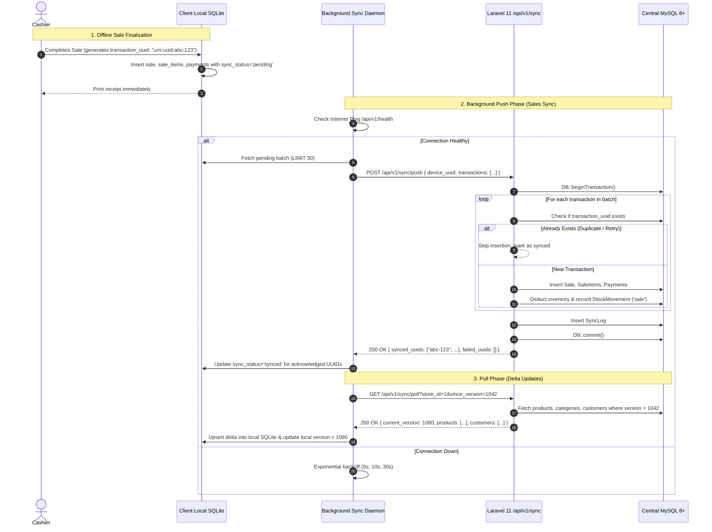

# SmartShop POS — Offline-First Synchronization Engine

## 1. Overview & Architecture

Retail stores cannot tolerate point-of-sale downtime due to ISP failures, bad Wi-Fi, or cloud outages. SmartShop POS implements a **strict offline-first architecture**:
1. Every cashier lane operates independently using a local SQLite embedded database.
2. Sales, item scans, discounts, split payments, and receipt prints execute locally with sub-second response times.
3. Completed sales are placed into a local `sync_queue` with `sync_status = 'pending'`.
4. A background sync worker continuously monitors connectivity and synchronizes records bidirectionally when the online server is reachable.

---

## 2. Synchronization Flow



---

## 3. Core Synchronization Protocols

### 3.1 Idempotency Guard & Deduplication
- **Unique Constraint**: The central database strictly enforces `UNIQUE KEY (transaction_uuid)`.
- **Handling Network Drops**: If the client sends a push request, the server commits it, but the client disconnects before receiving the HTTP 200 response:
  - On reconnect, the client will re-send the exact same batch.
  - The server checks `Sale::where('transaction_uuid', $tx['transaction_uuid'])->first()`.
  - When detected, the server **does not** re-insert or double-deduct inventory. It returns the UUID in `synced_uuids` so the client updates local status to `synced`.

### 3.2 Inventory Conflict Strategy
- **Offline Authority**: The client allows the checkout to complete even if local cached stock reaches zero or is out of sync with other lanes. In retail, serving the physical customer in the store always takes precedence over digital locks.
- **Server Reconciliation**: When the sale reaches the server:
  1. The server updates `inventory.quantity_on_hand -= sold_quantity`.
  2. A `stock_movements` row is inserted linking `reference_uuid = transaction_uuid`.
  3. If stock drops below 0, a `negative_stock_warning` flag is registered for manager audit in Filament.

### 3.3 Versioned Delta Pull
To prevent transmitting thousands of product rows every sync cycle:
1. Every `Product`, `Category`, and `Customer` record has an integer `version` field that increments on every update.
2. The client records its `last_synced_version`.
3. The request `GET /api/v1/sync/pull?since_version=1042` fetches only the modified records.
4. Client executes an atomic SQLite transaction replacing or upserting only those keys.

---

## 4. Sync API Contracts

### `POST /api/v1/sync/push`
#### Request Payload:
```json
{
  "device_uuid": "550e8400-e29b-41d4-a716-446655440000",
  "store_uuid": "3fa85f64-5717-4562-b3fc-2c963f66afa6",
  "transactions": [
    {
      "transaction_uuid": "7c9e6679-7425-40de-944b-e07fc1f90ae7",
      "invoice_number": "INV-2026-00104",
      "cashier_uuid": "2b2a6f23-6447-49f0-b5ec-8f43c3325c89",
      "customer_uuid": null,
      "subtotal": 45.00,
      "discount_amount": 5.00,
      "tax_amount": 4.00,
      "total_amount": 44.00,
      "paid_amount": 50.00,
      "change_amount": 6.00,
      "sold_at": "2026-09-14T16:45:00Z",
      "items": [
        {
          "product_uuid": "9b1deb4d-3b7d-4bad-9bdd-2b0d7b3dcb6d",
          "quantity": 2,
          "unit_price": 22.50,
          "discount_amount": 2.50,
          "tax_amount": 2.00,
          "total": 44.00
        }
      ],
      "payments": [
        {
          "payment_method": "cash",
          "amount": 50.00,
          "reference_number": null,
          "paid_at": "2026-09-14T16:45:00Z"
        }
      ]
    }
  ]
}
```

#### Success Response (200 OK):
```json
{
  "status": "success",
  "synced_count": 1,
  "synced_uuids": [
    "7c9e6679-7425-40de-944b-e07fc1f90ae7"
  ],
  "failed_uuids": [],
  "server_timestamp": "2026-09-14T16:45:02Z"
}
```
