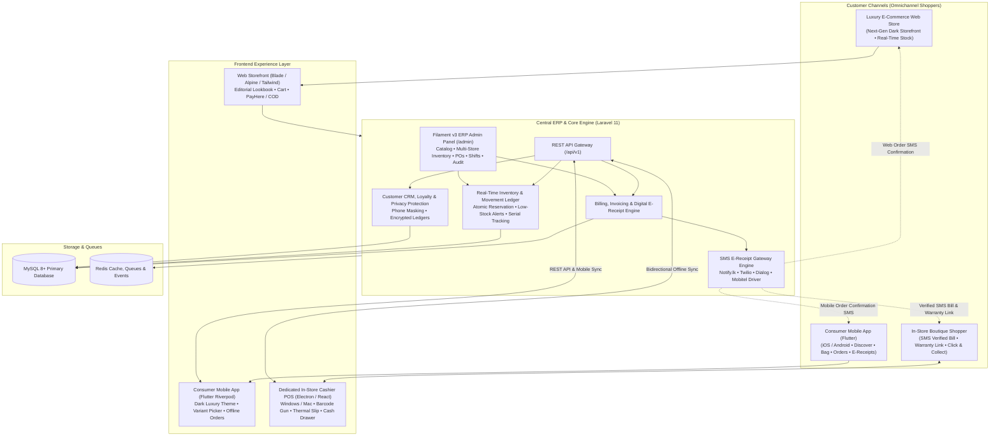
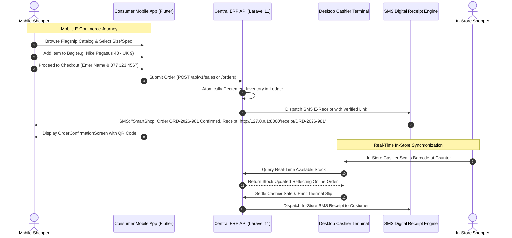

# SmartShop Omnichannel Retail Ecosystem — Master Architectural Blueprint

> **System Scope**: Consumer E-Commerce Web Store + Consumer Mobile App (Flutter) + Dedicated Desktop Cashier POS (Windows/Mac) + Central ERP & Filament v3 Admin + Real-Time Omnichannel Inventory + SMS Digital E-Receipts
> **Document Version**: 3.0.0
> **Target Business Profile**: High-End Flagship Multi-Department & Lifestyle Retailers (Smartphones & Tech, Designer Fashion & Apparel, Footwear & Sneakers, Luxury Automobili & High-Value Assets)
> **Commercial Readiness**: Turnkey Solution Ready for Commercial Licensing & Deployment to Established Retail Enterprises

---

## 1. Executive Summary & Commercial Positioning

SmartShop is an enterprise-grade omnichannel retail platform designed for **premier multi-department retail chains, luxury fashion houses, flagship electronics stores, and high-value asset dealers**.

Unlike basic point-of-sale systems built for small corner groceries or simple kiosks, SmartShop delivers a unified multi-channel retail infrastructure that connects:
1. **Consumer Mobile Shopping App (Flutter iOS & Android)**: An editorial, dark luxury mobile store mirroring the web experience. Shoppers discover collections, review variant matrices (sizes, storage, colors), manage their bag, checkout with online card/COD, and receive verified SMS digital e-receipts and warranty cards.
2. **Customizable E-Commerce Web Storefront (`apps/web-store` & Central Web Store)**: High-converting luxury web storefront providing instant island-wide ordering, real-time stock availability, and automated sync with central ERP inventory.
3. **Dedicated In-Store Cashier POS (Windows & macOS Desktop)**: A counter checkout terminal designed exclusively for store cashiers and staff, featuring barcode gun scanning, thermal ESC/POS receipt printing, cash drawer kickout, customer-facing pole display, staff shifts (X/Z reports), and offline SQLite durability.
4. **Central Cloud ERP & Filament v3 Admin (`/admin`)**: Unified multi-branch control panel for catalog management, stock movement ledgers, purchase orders, vendor procurement, role-based permissions, and commercial analytics.
5. **Customer Protection & Verified SMS E-Receipts Gateway**: Modular driver interface (supporting Notify.lk, Twilio, Dialog, Mobitel, and Mock modes) that dispatches instant digital bill summaries and tamper-evident warranty links to customers via SMS.

---

## 2. Omnichannel Architecture Diagram

---

## 3. High-End Retail Department Capabilities

| Department Vertical | Customer Mobile & Web Storefront | In-Store Desktop Cashier POS | Central ERP & Inventory Governance |
| :--- | :--- | :--- | :--- |
| **Smartphones & Flagship Tech** *(Apple, Samsung, Sony, Anker)* | • Storage & color variant matrix • Real-time stock status at flagship branch • Technical specs & Apple Care warranty badges • Verified SMS e-receipt with IMEI warranty link | • Mandatory IMEI / Serial capture per piece • High-speed barcode / QR gun scan • Multi-tender (Card + Cash + Installments) • Warranty terms printed on 80mm thermal slip | • Serialized stock movement tracking • Supplier warranty return logs • Reorder point alerts for high-demand devices • Margin analysis across brand tiers |
| **Designer Fashion & Apparel** *(Studio Ceylon, Zara, Ralph Lauren, Levi's)* | • High-resolution lifestyle imagery & lookbook • Size selector (XS, S, M, L, XL, XXL) • Fitting room guide & fabric composition • Express courier or click-and-collect at boutique | • Fast size & color lookup • Fitting room Held Bills with multi-lane recall • Exchange refunds & credit vouchers • Customer loyalty tier discounts | • Size $\times$ Color variant matrix generator • Seasonal markdown & collection promotion engine • Category hierarchy (Haute Couture, Casual, Accessories) |
| **Footwear & Sneakers** *(Nike, Adidas, Clarks, Puma)* | • UK / US / EU sizing matrix with fit notes • Pair availability badge per shoe model • Quick-add to bag with size confirmation • Return & exchange policy FAQs | • Pair barcode scanning with box SKU validation • Shoe size breakdown on receipt • In-store try-on hold bills • Split tender payment | • Per-size safety stock buffers • Automatic purchase order drafting when key sizes hit low levels • Supplier defect tracking |
| **Luxury Automobili & High-Value Assets** *(Toyota, Land Rover, BYD, Honda)* | • Vehicle showcase with battery & engine specs • Multi-million rupee price handling (`Rs. 48,500,000.00`) • Reserve online with bank transfer or boutique deposit • Official manufacturer warranty badges (3-8 yrs) | • Chassis / VIN number capture • High-value split tenders (Bank Transfer + Card + Cash) • Formal legal sales invoice generation • Manager override authorization | • Chassis & VIN ledger with inspection history • High-value asset insurance and warranty logs • Detailed financial revenue analytics |

---

## 4. UI Design System & Aesthetics (Matching `store_web`)

The entire ecosystem adheres to an editorial, modern luxury aesthetic:

* **Obsidian Palette**:
  * Base Background: `#0A0E17` (Obsidian black)
  * Surface Container: `#111827` (Deep slate)
  * Card Background: `#162032` (Elevated dark card with subtle rounded radius)
  * Hairline Borders: `#223048` (1px subtle luxury borders, no harsh drop shadows)
  * Primary Accent: `#10B981` (Refined emerald for live stock and success states)
  * Luxury Gold Accent: `#D4AF37` (Champagne gold for brand badges, VIP tiers, and verified warranties)
  * Tech Accent: `#06B6D4` (Cyan for tech specifications and digital links)
* **Typography**:
  * Primary Headings: Outfit / Google Fonts sans-serif, bold, elegant letter-spacing
  * Body & Metadata: Inter, crisp, clean silver `#94A3B8` and white `#F8FAFC`
  * Sinhala Support: Noto Sans Sinhala for authentic bilingual representation

---

## 5. Omnichannel Workflow: E-Commerce Mobile App to Central Inventory

---

## 6. Commercial Turnkey Deployment Package

When delivering this system to a commercial enterprise, the deployment package includes:
1. **Cloud Central ERP & Admin**: Hosted on AWS / DigitalOcean / On-Premise Docker stack (`backend/laravel-api`).
2. **Branded Web Storefront**: Configured with custom domain, merchant logo, PayHere / Stripe payment keys, and cloud storage.
3. **Consumer Mobile Apps**: Distributed via Apple App Store & Google Play Store, branded for the enterprise.
4. **Lane Cashier Terminals**: Packaged Electron executable for Windows / macOS POS hardware (touchscreen POS, barcode gun, 80mm ESC/POS printer, RJ11 cash drawer).
5. **SMS Provider Integration**: Live API keys for Notify.lk, Dialog, or Twilio with custom sender ID (e.g., `SMARTSHOP`).
