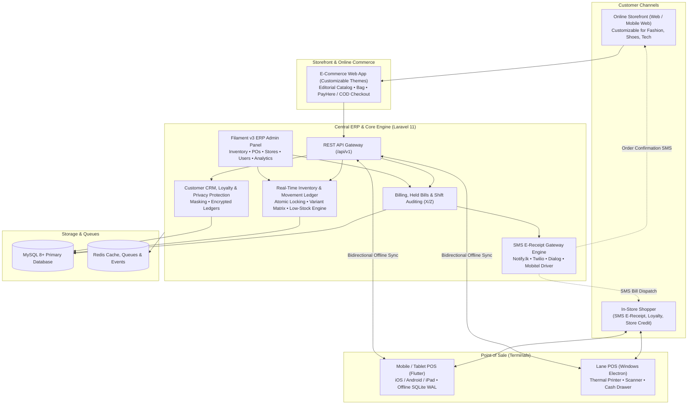

# SmartShop Omnichannel Retail Ecosystem — Master Architectural Blueprint

> **System Scope**: POS System + Central ERP + Customizable E-Commerce Web Storefront + Mobile App + Inventory Management + Customer Privacy & SMS Gateway
> **Document Version**: 2.0.0
> **Date**: October 2026

---

## 1. Executive Summary & Vision

SmartShop is an enterprise-grade omnichannel retail platform designed to fulfill the end-to-end operational needs of diverse modern retail businesses—specifically **Mobile Device & Electronics Stores**, **Clothing & Apparel Boutiques**, **Shoe & Footwear Shops**, and **General Supermarkets**.

The platform converges five core pillars into a single unified source of truth:
1. **High-Speed In-Store POS (Flutter Mobile POS & Windows POS)**: Fast checkout, barcode camera and gun scanning, serial/IMEI capture, thermal receipt printing, cash drawer kickout, held bills, and SQLite WAL offline durability.
2. **Central ERP Management (Laravel 11 + Filament 3 Admin)**: Multi-branch inventory tracking, supplier purchasing, goods receiving, stock movement audit ledgers, accounting summaries, and role-based access control.
3. **Customizable E-Commerce Web Storefront**: High-converting, editorial web storefront (inspired by the clean aesthetics of the `store_web` architecture) that synchronizes inventory, pricing, variants, and orders in real-time with physical store terminals.
4. **Customer Protection & Privacy Engine**: Screen-level phone masking, encryption at rest, role-scoped customer access, and compliant data governance.
5. **SMS Digital E-Receipts Gateway**: Modular driver interface (supporting Notify.lk, Twilio, Dialog, Mobitel, and Mock modes) that dispatches instant digital bill summaries and receipt links to customers via SMS upon in-store or online checkout.

---

## 2. Omnichannel Architecture Diagram



---

## 3. Store Vertical Capabilities

| Store Vertical | In-Store POS Requirements | E-Commerce Web Storefront Requirements | ERP & Central Inventory Control |
| :--- | :--- | :--- | :--- |
| **Mobile & Electronics** | • Mandatory IMEI / Serial capture per line item<br>• Warranty period tracking printed on receipts<br>• Fast barcode / QR camera & gun scanning | • Specification filters (Storage, RAM, Color)<br>• Serial warranty validation portal for buyers<br>• Accessory upsell bundles at checkout | • Serialized stock movement tracking<br>• Supplier warranty return logs<br>• Brand-level profit margin analysis |
| **Clothing & Apparel** | • Size & Color variant lookups<br>• Held bills for fitting-room shoppers<br>• Customer loyalty points & size exchange refunds | • Editorial lookbook & seasonal collection banners<br>• Interactive Size Chart guides<br>• Color swatch selection & image carousels | • Matrix variant generator (Size $\times$ Color)<br>• Seasonal markdown & promotion engine<br>• Fabric & style category taxonomy |
| **Shoe & Footwear** | • UK / US / EU sizing variant selection<br>• Pair / Box unit of measure (`unit`)<br>• Return policy footer on thermal slips | • Size availability badges per shoe model<br>• Fit recommendations & return policy FAQ<br>• Filter by Gender, Sport, Brand, Size | • Per-size safety stock buffers<br>• Automatic purchase suggestions when popular sizes hit low threshold |
| **Supermarkets & Groceries** | • Decimal quantities (`decimal:3`) for weighted items<br>• Bilingual English + Sinhala receipt names<br>• Split tender (Cash + Card + Credit) | • Islandwide / local delivery slot selection<br>• Minimum order value thresholds<br>• Fast re-ordering from previous purchases | • Expiry date tracking & batch numbers<br>• Bulk purchasing from distributors<br>• Weighing scale barcode label parsing |

---

## 4. UI Design System & Aesthetics (Inspired by `store_web`)

The entire user experience—across the Mobile POS, the Web Storefront, and the ERP—follows the editorial, refined luxury aesthetic established in `store_web`, translated into a modern **Dark Theme**:

* **Obsidian Palette**:
  * Base Background: `#0A0E17` (Obsidian dark)
  * Surface Container: `#111827` (Deep slate)
  * Card Background: `#162032` (Elevated dark card with 12-14px radius)
  * Hairline Borders: `#223048` (1px subtle luxury borders instead of heavy drop shadows)
  * Primary Accent: `#10B981` (Refined emerald for high-contrast actions and success states)
  * Secondary Tech Accent: `#06B6D4` (Cyan for IMEI / Serial tags)
  * Luxury Gold Accent: `#D4AF37` / `#F59E0B` (Amber gold for warranty badges and VIP status)
* **Editorial Typography**:
  * Headings: `Outfit` / `Georgia` for numbers, totals, and screen titles.
  * Body: `Inter` for crisp, high-legibility interface text and receipt items.
  * Micro-Badges: Uppercase letter-spaced tags (`letter-spacing: 0.08em`, 9.5-10px, bold).
* **Responsive Architecture**:
  * Adaptable for portrait mobile phone (one-handed queue busting), landscape tablet / iPad (split catalog 60% / cart 40%), and desktop widescreen.

---

## 5. Customer Protection, Data Privacy & SMS E-Receipts

### 5.1 Screen-Level Phone Masking
To prevent unauthorized shoulder-surfing at checkout queues, customer contact details are automatically masked in the terminal UI:
```dart
// Example: 0771234567 -> 077 **** 567
String masked = SmsService.maskPhoneNumber(customer.phone);
```

### 5.2 SMS Digital Bill Dispatch
When enabled, completing a transaction triggers an SMS receipt containing:
1. Store Name & Thank-you note
2. Invoice Reference Number
3. Total Amount & Payment Breakdown
4. Unique digital receipt link: `https://store.lk/receipt/INV-20261024-1029`

### 5.3 Gateway Architecture
A pluggable provider model enables switching SMS carriers without altering POS or business logic:
* `mock`: Local testing & simulation mode
* `notifylk`: Sri Lankan SMS Gateway (HTTP API / Sender ID)
* `dialog`: Direct operator enterprise SMS API
* `mobitel`: mBiz enterprise SMS API
* `twilio`: International SMS Gateway

---

## 6. Real-Time Inventory & Order Synchronization

1. **Central Master Inventory**: All products, variants, and stock balances reside in the Laravel backend database.
2. **Terminal In-Store Sale**:
   - Committed locally to SQLite WAL in $<15$ milliseconds.
   - Pushed via `/api/v1/sync/push` to central cloud.
   - Cloud inventory decrements atomically; online storefront immediately displays updated available stock.
3. **Web Storefront Online Order**:
   - Customer completes checkout on the website (COD or PayHere).
   - Order reservation locks inventory; POS terminals receive updated stock on the next sync pull.
   - Store staff can see and pack online orders directly from the terminal or admin panel.
